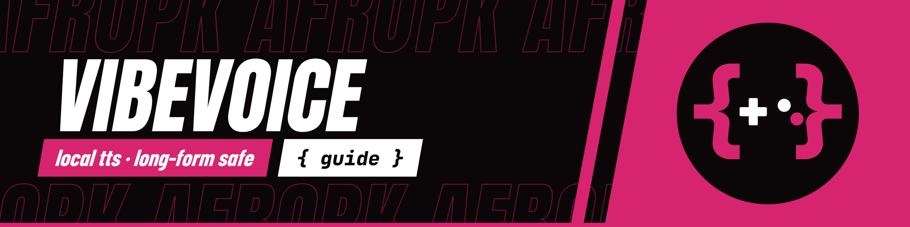
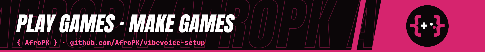

<p align="center">
  
</p>

<p align="center">
  
  
  
  
</p>

<p></p>

**`{ vibevoice-setup }`**: a from-scratch tutorial for VibeVoice 1.5B as an OpenAI-compatible TTS server, without the two things that break long narration.

VibeVoice clones a voice zero-shot from a reference clip, and it sounds good — right up until the last sentence gets cut off or the same sentence repeats five times. This guide fixes both, then runs the server so any pipeline can call `/v1/audio/speech`.

Every command is concrete and every file is shown. A human or an AI agent can follow it.

<p></p>

**Needs:** Linux (Ubuntu/Debian; Windows works with ROCm builds) · Python 3.10-3.12 · GPU with 8 GB+ VRAM · `ffmpeg` · `git`

```bash
git clone https://github.com/vibevoice-community/VibeVoice
cd VibeVoice
python3 -m venv .venv
source .venv/bin/activate
pip install -e . torch torchaudio transformers accelerate soundfile gradio scipy numpy
python -c "import vibevoice; print('vibevoice ok')"
```

1. Install the torch build for your GPU: NVIDIA `--index-url https://download.pytorch.org/whl/cu126`, AMD ROCm `--index-url https://download.pytorch.org/whl/rocm6.2`. Apple Silicon defaults to fp16 on MPS.
2. Download the 1.5B checkpoint into `models/`.
3. Run the bundled demo once to confirm the model loads.
4. For AMD: `export HSA_OVERRIDE_GFX_VERSION=10.3.0` and `export PYTORCH_NO_HIP_MEMORY_CACHING=1`.

<p></p>

| Problem | Symptom | Fix |
|---|---|---|
| Tail truncation | last sentence missing on long chapters | `max_length_times=8` (stock is 2) |
| Repetition loop | same sentence 3-5 times | sampling instead of greedy: `use_sampling=True`, `temperature=0.8`, `top_p=0.9` |

The decoder's length cap is too small for long narration, so it stops early — thread `max_length_times` through the demo and server layers. Greedy decode loops on long inputs, so sample instead; a fixed seed keeps takes reproducible.

The reference voice matters as much as the code: 5-15 s of clean speech, and a transcript that matches the audio exactly. Mismatches are the number one quality killer.

<p></p>

```bash
./run_vibevoice_server.sh
# VibeVoice server up on :8000

curl -s -X POST http://127.0.0.1:8000/v1/audio/speech \
  -H "Content-Type: application/json" \
  -d '{"input":"Hello world.","response_format":"wav"}' --output hello.wav
```

The launcher is env-driven: `DEVICE` (`cuda`, `cpu`, `mps`), `MODEL_PATH`, `HOST`, `PORT`, `INFERENCE_STEPS`. Voices dropped in `demo/voices/<name>.wav` are selectable by name through `GET /voices`.

<p></p>

| Field | Default | |
|---|---|---|
| Endpoint | — | `POST /v1/audio/speech` |
| `input` | — | the text to speak |
| `response_format` | `wav` | or `json` |
| `inference_steps` | `10` | more is sharper and slower |
| `max_length_times` | `8` | length cap, keep it high |
| Health | — | `GET /health`, `GET /voices` |

<p></p>

- 6 GB VRAM works in low-vram mode but is tight for long audio.
- First run downloads the Whisper and Kokoro models; the first generation is slow.
- If the tail still truncates, check `max_length_times` actually reaches the generation call. If it loops, check sampling is on.
- Upstream VibeVoice is MIT. This tutorial is MIT and contains no private config or credentials.

<p align="center">
  
</p>
